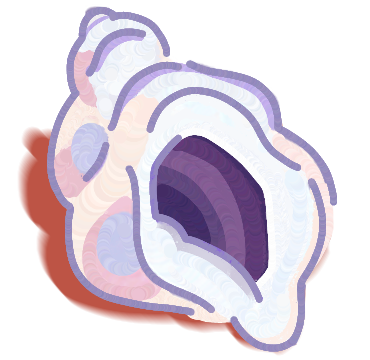

**Caracola** is an audio transcription service with speaker diarization and word-level timestamps, running at the supercomputing center of the Universidad Nacional de Córdoba ([CCAD](https://supercomputo.unc.edu.ar/)). Transcripts are reviewed in a browser editor with synced audio playback, and results are delivered to the browser encrypted.

### Try it

- **UNC account (`@unc.edu.ar`):** [caracola.ccad.unc.edu.ar](https://caracola.ccad.unc.edu.ar)
- **No UNC account:** [caracola.ai](https://caracola.ai), with a beta access code you can request at [info@caracola.ai](mailto:info@caracola.ai)

### Repositories

- [**caracola**](https://github.com/caracola-ai/caracola): overview, privacy and architecture.
- [**ffmpeg-wasm**](https://github.com/caracola-ai/ffmpeg-wasm): the LGPL FFmpeg WebAssembly build Caracola uses to compress large files in the browser.
